# Deploy a VPC + Public EC2 Web Server with AWS CloudFormation

A hands-on lab where **one CloudFormation template builds an entire network from scratch** (VPC, Internet Gateway, public and private subnets across two Availability Zones, route tables) and then launches an Apache web server in a public subnet.

No default VPC is used. Everything is created, and later destroyed, by a single stack.

## Architecture

```
                         Internet
                             |
                    [ Internet Gateway ]
                             |
 +------------------- VPC 10.1.0.0/16 -------------------+
 |                                                        |
 |   AZ-a                          AZ-b                   |
 |   +------------------------+    +------------------+   |
 |   | Public-A 10.1.10.0/24  |    | Public-B         |   |
 |   |  [ EC2 + Apache ]      |    |  10.1.20.0/24    |   |
 |   |  SSH 22 | HTTP 80      |    |                  |   |
 |   +------------------------+    +------------------+   |
 |        Public-RT:  0.0.0.0/0 -> IGW                    |
 |                                                        |
 |   +------------------------+    +------------------+   |
 |   | Private-A 10.1.50.0/24 |    | Private-B        |   |
 |   |  (no internet route)   |    |  10.1.60.0/24    |   |
 |   +------------------------+    +------------------+   |
 |        Private-RT: local only                          |
 +--------------------------------------------------------+
```

| Resource | Details |
|---|---|
| VPC | `Lab-VPC`, CIDR `10.1.0.0/16`, DNS support and hostnames enabled |
| Internet Gateway | `Lab-IGW`, attached to the VPC |
| Public subnets | `Public-A` `10.1.10.0/24` (AZ-a), `Public-B` `10.1.20.0/24` (AZ-b), auto-assign public IP on |
| Private subnets | `Private-A` `10.1.50.0/24` (AZ-a), `Private-B` `10.1.60.0/24` (AZ-b) |
| Public route table | `Public-RT`: `0.0.0.0/0` to the Internet Gateway, associated with both public subnets |
| Private route table | `Private-RT`: local route only (no internet), associated with both private subnets |
| Security group | `Lab-Web-SG`: SSH (22) from the `SSHLocation` parameter, HTTP (80) from anywhere |
| EC2 instance | `Lab-Public-EC2`, Amazon Linux 2023, `t3.micro`, in `Public-A` with a public IP, Apache installed through `UserData` |

**No key pair is used.** I connect with **EC2 Instance Connect**, which pushes a temporary SSH key from the browser.

## Repository structure

```
.
├── README.md
├── templates/
│   └── VPC-EC2-Public.yaml
└── images/            # Console screenshots used below
```

## Template parameters

| Parameter | Default | Purpose |
|---|---|---|
| `InstanceType` | `t3.micro` | EC2 instance size |
| `LatestAmiId` | `/aws/service/ami-amazon-linux-latest/al2023-ami-kernel-default-x86_64` | SSM public parameter that resolves to the latest Amazon Linux 2023 AMI, so no hard-coded AMI ID |
| `SSHLocation` | `0.0.0.0/0` | CIDR allowed to SSH. Use your own IP (`x.x.x.x/32`) for anything beyond a lab |

## Outputs

`VpcId`, `PublicSubnets`, `PrivateSubnets`, `InstanceId`, `PublicIP`, `WebURL`

---

## Walkthrough

### Task 1: Create the stack

CloudFormation > **Create stack** > *Choose an existing template* > *Upload a template file* > select `VPC-EC2-Public.yaml`.

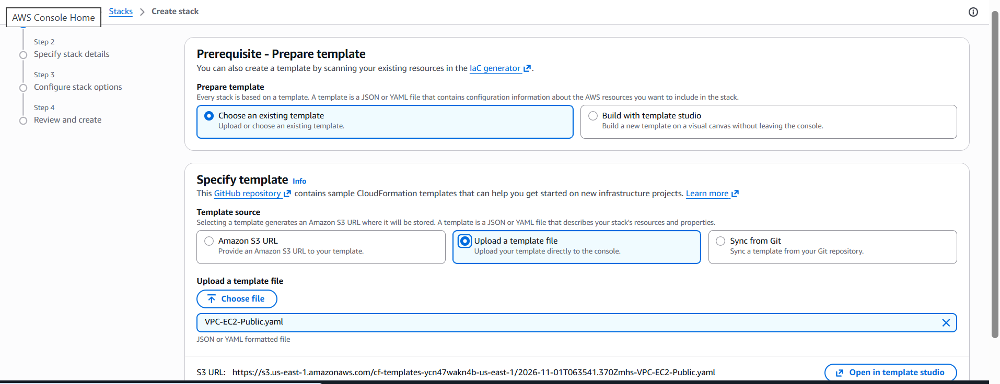

Name the stack `VPC-EC2-Lab`. The three parameters appear with their defaults and I left them unchanged. I used no key pair.

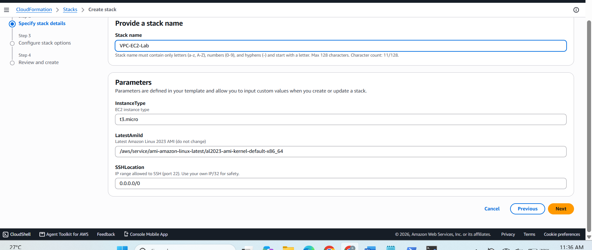

The stack reaches `CREATE_COMPLETE` and all resources are created in dependency order. CloudFormation works out that the Internet Gateway attachment must exist before the public route, and that the route must exist before the instance starts.

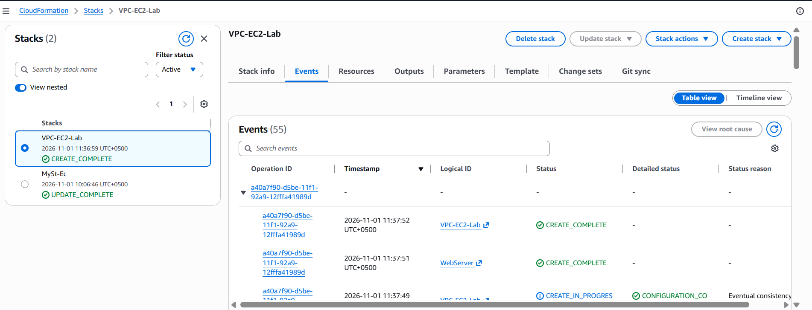

### Task 2: Verify the network

VPC console > **Your VPCs**. Besides the default VPC (`172.31.0.0/16`) there is now `Lab-VPC` with CIDR `10.1.0.0/16`.

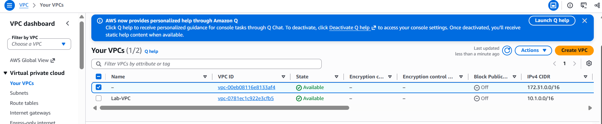

Opening `Lab-VPC` shows it is **Available**, **not** the default VPC, with DNS hostnames **enabled**. (The owner account ID is blacked out.)

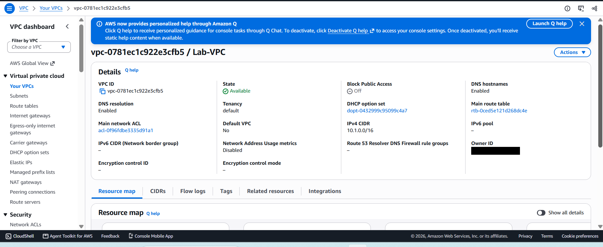

VPC console > **Internet gateways**. `Lab-IGW` is **Attached** to `Lab-VPC`. The other gateway, `my-igw`, belongs to the default VPC and comes from an earlier lab.

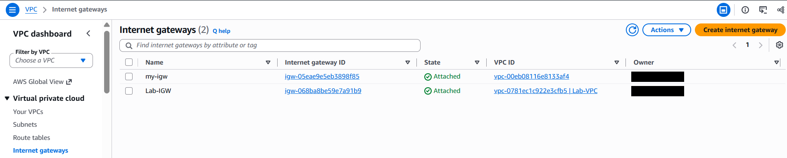

### Task 3: Route tables

The template defines two route tables, which can be checked under VPC > **Route tables**:

| Route table | Routes | Associated subnets |
|---|---|---|
| `Public-RT` | `10.1.0.0/16` local, `0.0.0.0/0` to Internet Gateway | Public-A, Public-B |
| `Private-RT` | `10.1.0.0/16` local only | Private-A, Private-B |

This is what makes a subnet "public" or "private": a route to the Internet Gateway, nothing else.

### Task 4: Check the instance

EC2 > **Instances**. `Lab-Public-EC2` is **Running**, passed **3/3 status checks**, and sits in `us-east-1a` with a public IPv4 address.

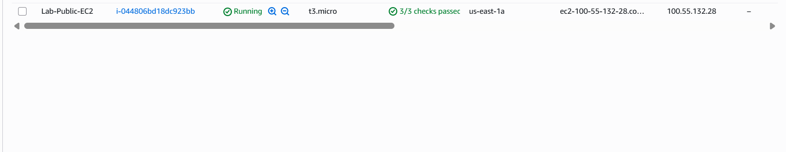

### Task 5: Connect and test

**Connect with EC2 Instance Connect:** select the instance > **Connect** > *EC2 Instance Connect* > username `ec2-user` > **Connect**.

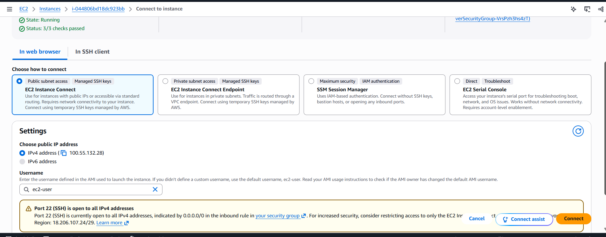

A browser terminal opens. The prompt shows `ip-10-1-10-65`, a private address inside `10.1.10.0/24`, which confirms the instance really is in the `Public-A` subnet.

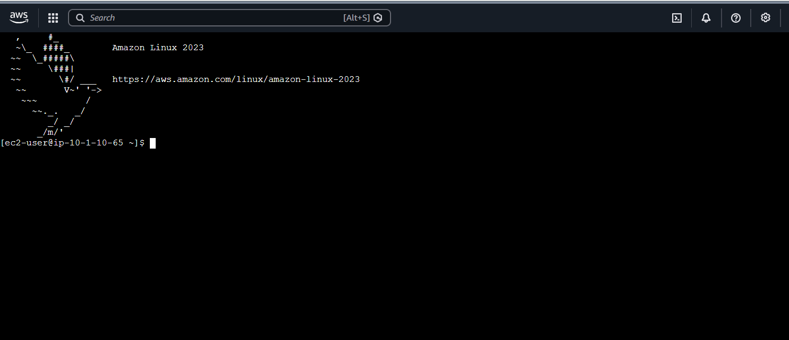

**Open the website:** the stack **Outputs** tab lists the public IP, the VPC and subnet IDs, and the `WebURL`.

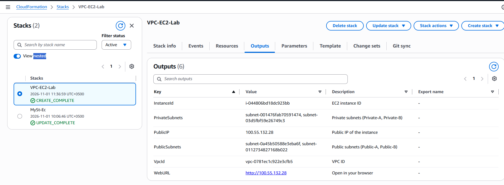

Browsing to the `WebURL` shows the page served by Apache from the instance's `UserData`:

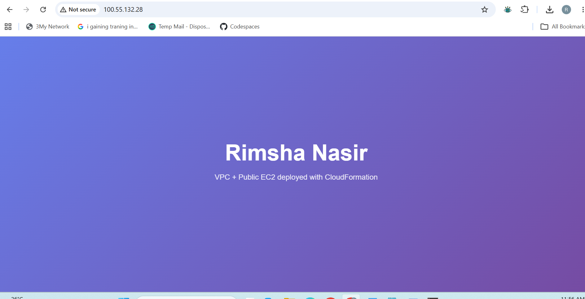

### Task 6: Clean up

CloudFormation > select `VPC-EC2-Lab` > **Delete**. Then check the VPC and EC2 consoles to confirm the VPC, Internet Gateway, subnets, route tables, security group and instance are all gone. This is the benefit of Infrastructure as Code: one action removes everything the template created.

---

## What I learned

- A subnet is **public** only because its route table sends `0.0.0.0/0` to an Internet Gateway. The private subnets differ only in having no such route.
- `DependsOn` and `Ref` let CloudFormation create resources in the right order (gateway attachment, then route, then instance).
- Building the VPC inside the template makes the lab independent of whatever the account's default VPC looks like. This mattered because my default VPC had no Internet Gateway in an earlier lab (see my companion repository, *aws-cloudformation-apache-ec2*).
- EC2 Instance Connect avoids key pair handling for short-lived lab instances.

## Security notes

- `SSHLocation` defaults to `0.0.0.0/0` to keep the lab simple. Restrict it to your own IP for real use.
- Private subnets have no route out. Adding outbound access would need a NAT gateway, which is billed hourly.
- The AWS account ID was redacted from the screenshots.

## Author

**Rimsha Nasir**
